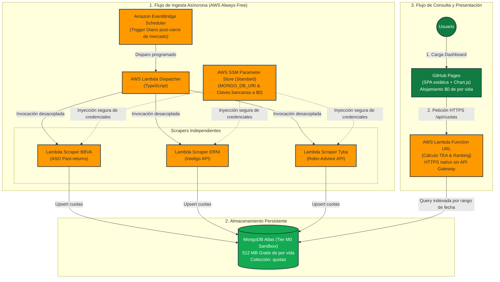

# Fondos Mutuos Perú

Plataforma de seguimiento y comparación de valor cuota y rendimiento neto de comisiones para fondos mutuos peruanos (**BBVA**, **ERNI / Inteligo** y **Tyba / Credicorp Capital**).

El proyecto implementa una **arquitectura Serverless desacoplada en AWS (Always Free Tier)** gobernada por **Spec-Driven Development (SDD)**, manteniendo a su vez un acceso monolítico legado desplegado en **Fly.io**.

Rendimiento de la tabla: variación del periodo neta de comisión, `(último / primero - 1) * (100 - fee)`.

---

## 1. Arquitectura Serverless Desacoplada (AWS Always Free)

La modernización del proyecto traslada la ingesta y consulta a una infraestructura en la nube sin servidores 24/7, garantizando un **costo mensual de \$0.00 de por vida**:



### Principios del Desacoplamiento:
1. **Desacoplamiento Temporal (Ingesta vs Consulta):** No hay servidores encendidos 24/7. La extracción corre en pocos segundos una vez al día con EventBridge.
2. **Aislamiento por Proveedor:** Cada banco/SAF tiene su propia función Lambda aislada. Si una API externa cambia su contrato o tiene downtime, no impacta a las demás fuentes ni a la API de consulta.
3. **Optimización de Costos (\$0 Always Free):**
   - **AWS Lambda:** 1,000,000 invocaciones/mes gratuitas de por vida.
   - **Amazon EventBridge Scheduler:** 14,000,000 invocaciones/mes gratuitas de por vida.
   - **Lambda Function URLs:** Permite HTTPS directo y CORS sin necesidad de pagar por Amazon API Gateway tras los primeros 12 meses.
   - **AWS SSM Parameter Store (Standard):** Secretos a costo \$0 (reemplaza a AWS Secrets Manager).
   - **MongoDB Atlas (M0 Sandbox):** 512 MB sin cobro de RCU/WCU por lecturas analíticas masivas (ver [`IF-001`](specs/intentos-fallidos.md)).
   - **GitHub Pages:** Hosting estático gratuito e ilimitado para el dashboard.
4. **Infraestructura como Código (IaC):** Definida mediante **AWS CDK en TypeScript** bajo el directorio `infra/`.

---

## 2. Metodología Spec-Driven Development (SDD)

El proyecto se gestiona mediante la metodología **Spec-Driven Development** en [`specs/`](specs/README.md):
- [`specs/mission.md`](specs/mission.md) — Misión del producto, usuarios objetivo y alcance.
- [`specs/constitution.md`](specs/constitution.md) — Reglas y restricciones no negociables (presupuesto \$0, TypeScript estricto, TDD, convivencia con el legado).
- [`specs/tech-stack.md`](specs/tech-stack.md) — Justificación de tecnologías y alternativas analizadas.
- [`specs/roadmap.md`](specs/roadmap.md) — Fases de evolución del proyecto.
- [`specs/intentos-fallidos.md`](specs/intentos-fallidos.md) — Registro de enfoques descartados (ej. `IF-001`: descarte de DynamoDB por estrangulamiento de RCU/WCU).

---

## 3. Servidor Monolítico Legado (Fly.io / Express)

El acceso y despliegue tradicional mediante Express y Docker se mantiene plenamente disponible.

### Requisitos Locales
- Node.js 24+
- npm 12+
- MongoDB (local o Atlas)
- Claves de API de cada fuente

### Configuración
```bash
cp .env.example .env
```

| Variable | Uso |
| --- | --- |
| `PORT` | Puerto HTTP. Default `3000` |
| `NODE_ENV` | Si existe, carga también `.env.{NODE_ENV}` y pisa valores |
| `MONGO_DB_URI` | URI de MongoDB. Obligatoria |
| `ERNI_APIKEY` | Subscription key de Inteligo / ERNI |
| `TYBA_APIKEY` / `TYBA_AUTHORIZATION` | Token Bearer JWT (`authorization`) de Tyba |
| `TYBA_REFRESH_TOKEN` | Token opcional para auto-renovación transparente de sesión (HTTP 401) |
| `TYBA_APP_PROOF` | Cabecera `x-app-proof` de Tyba (opcional; se autogenera dinámicamente vía RSA-4096) |
| `BBVA_APIKEY` | Header `Tsec` de BBVA. En producción usa esto; evita Puppeteer |
| `SCRAPE_TOKEN` | Si está definida, `/api/*` exige `?token=` o `Authorization: Bearer` |
| `BBVA_HEADLESS` | `false` abre Chrome visible al capturar `tsec`. Default headless |

### Ejecución de Scrapers Serverless (Local)
Cada scraper modular puede ejecutarse de forma aislada en local antes o después de desplegar en AWS:

```bash
# Ingesta de ERNI (Inteligo)
npm run scrape:erni

# Ingesta de BBVA Asset Management
npm run scrape:bbva

# Ingesta bajo demanda de Tyba (Credicorp Capital)
npm run scrape:tyba -- --authorization "<token_jwt>" [--refresh-token "<token>"] [--days 30] [--dry-run]
```

### Servidor Express Unificado (Fly.io / Local)
El proyecto cuenta con un servidor Express en TypeScript (`src/server.ts`) que unifica la vista SSR del dashboard y todos los endpoints de ingesta y analítica, consumiendo directamente la lógica de dominio sin sobrecargar Fly.io con frameworks frontend pesados:

```bash
# Ejecución en desarrollo
npm run server

# Desarrollo con auto-recarga
npm run server:dev

# Compilar para producción
npm run build:server

# Iniciar servidor compilado
npm run start:server
```

Dashboard interactivo: [http://localhost:3000](http://localhost:3000)

### Endpoints del Servidor Express
| Método | Ruta | Descripción |
| --- | --- | --- |
| `GET` | `/` | Dashboard SSR interactivo con Chart.js, filtros y tabla. Query: `days` (1-3650, default 30), `currency` (`PEN` o `USD`), `risk` (máximo 1-7) |
| `GET` | `/api/tea` | Datos analíticos normalizados en formato JSON (`{ labels, datasets }`) con cabecera de caché |
| `GET` | `/health` | Health check (`200 OK` si Mongo está conectado; `503` si no) |
| `GET` | `/api/erni` | Dispara ingesta de ERNI (Inteligo). Requiere `SCRAPE_TOKEN`. Query: `days` |
| `GET` | `/api/bbva` | Dispara ingesta de BBVA vía API nativa. Requiere `SCRAPE_TOKEN`. Query: `days` |
| `GET` | `/api/tyba` | Dispara ingesta de Tyba. Requiere `SCRAPE_TOKEN` y cabeceras de sesión (`authorization`, `x-app-proof` opcional) |

### Despliegue en Fly.io
El despliegue en Fly.io utiliza un `Dockerfile` multi-stage ultraligero que compila el código TypeScript a JavaScript nativo y corre sobre Node 24 Alpine consumiendo menos de 40 MB de memoria:

```bash
fly deploy
```

---

## 4. Estructura del Repositorio

| Directorio / Archivo | Rol |
| --- | --- |
| `specs/` | Documentos fundacionales y especificaciones SDD por funcionalidad |
| `infra/` | Infraestructura como Código con AWS CDK v2 en TypeScript (`FondosStack`, Lambdas, EventBridge, Function URLs) |
| `src/scrapers/` | Módulos de ingesta y adaptadores bancarios serverless (ERNI, BBVA, Tyba) con `fetch` nativo |
| `src/domain/` | Motor matemático puro de variación relativa neta de comisiones (`tea.ts`) |
| `src/api/` | Handler de la AWS Lambda Function URL (`handler.ts`), esquemas TypeBox y servidor local |
| `src/views/` | Plantilla HTML para Server-Side Rendering (SSR) del dashboard sin dependencias de cliente |
| `src/server.ts` | Servidor Express unificado para despliegue en Fly.io y ejecución local |
| `src/shared/` | Conexión singleton a MongoDB Atlas, lectura de parámetros SSM y utilidades de concurrencia |
| `legacy/` | Código monolítico histórico en JavaScript puro (preservado para compatibilidad) |
| `Dockerfile` | Imagen Docker multi-stage optimizada para Fly.io |
| `fly.toml` | Archivo de configuración de la aplicación en Fly.io |
| `scripts/` | Validadores de especificaciones (`validate_sdd.py`, `check_constitution.py`) |
